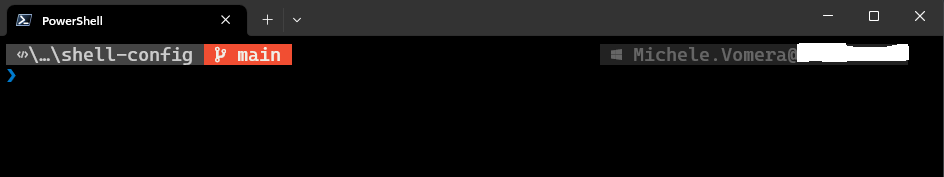
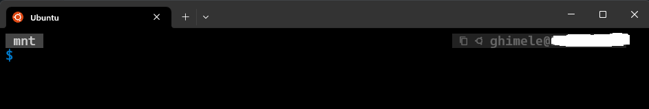

# 🔥 My Shell Config


## About
This is my shell configuration using **oh-my-posh**.






I've created my own theme based on [Tiwahu](https://ohmyposh.dev/docs/themes#tiwahu) theme that is supplied with Oh-My-Posh

## Installation
Follow the installation instructions from [Oh-My-Posh](https://github.com/JanDeDobbeleer/oh-my-posh) to install Oh-My-Posh

- For Bash shell I've created a simple script [oh-my-posh-install.sh](scripts/oh-my-posh-install.sh)

- For Windows, install or update **App Installer** from the Microsoft Store if `winget` is unavailable. Then, from the repository directory:
  1. Run [oh-my-posh-install.bat](scripts/oh-my-posh-install.bat) to install Windows Terminal, PowerShell 7, and Oh My Posh:

     ```powershell
     .\scripts\oh-my-posh-install.bat
     ```

     Already-installed packages are skipped. Start from a normal terminal; approve an installer elevation prompt only if requested.
  2. Close the terminal completely so the updated `PATH` is picked up. Open Windows Terminal and select **PowerShell** (PowerShell 7, `pwsh`), not **Windows PowerShell** (5.1).
  3. From the repository directory, run [oh-my-posh-config.ps1](scripts/oh-my-posh-config.ps1) as your normal user:

     ```powershell
     .\scripts\oh-my-posh-config.ps1
     ```

     This installs the CascadiaCode Nerd Font, copies the configuration and theme to `%LOCALAPPDATA%\shell-config`, and adds a small managed loader to your PowerShell 7 profile while preserving other content. Repeat runs refresh the installed copies and loader, and changed existing profiles are backed up beside `$PROFILE`. Use `-SkipFontInstall` if the font is already installed.
  4. In Windows Terminal settings, select the installed **CaskaydiaCove Nerd Font** for your PowerShell profile. Open a new PowerShell 7 session to load the prompt.

### Version-Controlled Configuration

The repository stores the source configuration, but is not needed at shell startup. Setup installs [powershell-profile.ps1](scripts/powershell-profile.ps1) into `%LOCALAPPDATA%\shell-config\scripts` and [ghimele.omp.json](oh-my-posh-theme/ghimele.omp.json) into `%LOCALAPPDATA%\shell-config\oh-my-posh-theme`. `$PROFILE` loads the installed copy using the current user's `LOCALAPPDATA`, not a checkout path.

You can move or remove the checkout after installation. To update configuration, edit or pull the repository, run `scripts\oh-my-posh-config.ps1 -SkipFontInstall` from the checkout, and open a new PowerShell session. Setup overwrites the installed copies, so make lasting changes in the repository. On other machines sharing `$PROFILE` through OneDrive, run setup once per machine to install the local files.

Keep credentials, tokens, and machine-specific settings outside the repository. Review pulled profile changes before starting a new session, since profile code runs automatically.

### Windows Troubleshooting

- **Script execution is disabled:** run `Set-ExecutionPolicy -Scope CurrentUser RemoteSigned` if your organization's policy allows it. For a downloaded checkout, you may also need `Unblock-File .\scripts\oh-my-posh-config.ps1`.
- **`oh-my-posh` is not recognized:** close all terminal windows, reopen PowerShell 7, and check `Get-Command oh-my-posh`. If it is still missing, review the WinGet installation error.
- **Prompt is unchanged:** check `$PROFILE` in PowerShell 7. Windows PowerShell and PowerShell 7 use different profile files. Remove obsolete Oh My Posh initialization lines from previous manual setups if they conflict with the managed block.
- **Icons appear as boxes:** select the installed Nerd Font in Windows Terminal settings; installing a font does not select it automatically.

## Prerequisites

⚠ **You should use a modern console** host like the official Windows Terminal to have a great terminal experience on Windows. ⚠

## Technologies used

- [oh-my-posh](https://github.com/JanDeDobbeleer/oh-my-posh)
- [PowerShell](https://learn.microsoft.com/en-us/powershell/scripting/install/installing-powershell-on-windows?view=powershell-7.3)
- [Windows Teminal](https://learn.microsoft.com/en-us/windows/terminal/install#install)
